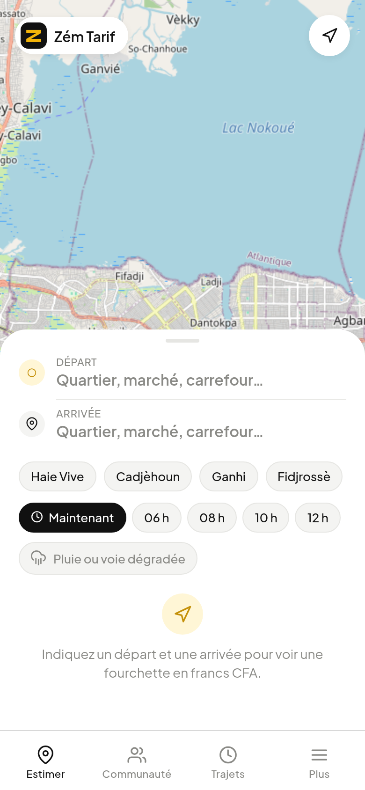

# Zém Tarif

Application pour estimer un prix raisonnable de course en zémidjan à Cotonou, Abomey-Calavi et Porto-Novo.

Le zém n’a pas de compteur. On se met d’accord avant de monter, selon la distance, l’heure et parfois la pluie. Il n’existe pas, à notre connaissance, de grille officielle ou syndicale en vigueur pour le zém de rue. Zém Tarif calcule une fourchette à partir d’un barème transparent, que les usagers peuvent ensuite corriger en indiquant le prix réellement payé.

Ce n’est pas un prix imposé, et ce n’est pas GoZem ni Yango.

Démo en ligne : [zem-tarif.onrender.com](https://zem-tarif.onrender.com)



## Fonctions

- Carte en plein écran, avec une feuille du bas pour le départ, l’arrivée et le résultat.
- Recherche d’un départ et d’une arrivée (repères habituels, ou OpenStreetMap via Nominatim).
- Itinéraire routier (OSRM). Si le calcul d’itinéraire échoue, la distance à vol d’oiseau est majorée de 25 %.
- Fourchette en francs CFA, avec la distance et une durée indicative.
- Majoration de nuit (22 h – 6 h, heure de Porto-Novo) et option « pluie ou voie dégradée ».
- Signalement du prix payé, conservé sur l’appareil.
- Historique des estimations.
- Écran « Méthode », avec les sources et les limites du modèle.
- L’application tourne dans Expo Go (Android) et dans un navigateur.

Un petit serveur FastAPI, facultatif, permet de rassembler les avis. Un schéma PostgreSQL prêt pour Supabase est fourni. Sans serveur, tout reste local.

## Le barème

Tous les coefficients tiennent dans `src/pricing/constantes.ts`. C’est le seul fichier à modifier si de nouveaux prix de terrain sont fournis.

```
prix = max(250 F, 150 F + 65 F × km)
puis, le cas échéant :
  × 1,25 la nuit (22 h – 6 h)
  × 1,30 s’il pleut ou si la voie est très dégradée
arrondi à 50 F
fourchette affichée : 85 % – 130 % du point central
```

Dès que trois avis d’usagers relient à peu près les mêmes deux points (dans un rayon d’un kilomètre à chaque bout), le point central glisse vers leur médiane, jusqu’à 65 % du poids. Les repères publiés ci-dessous ne sont pas des avis d’usagers et n’entrent pas dans ce mélange.

Les distances de calage ont été mesurées avec OSRM (profil routier). Le barème a été recalibré en novembre 2026, après la hausse du carburant officiel à 725 F le litre (1er mai 2026) et des témoignages plus récents sur les courses courtes.

Exemples, de jour et par temps sec :

| Trajet | Distance (ordre de grandeur) | Point central |
|---|---|---|
| Haie Vive – Cadjèhoun | ~2,4 km | 300 F (fourchette 250 – 400 F) |
| Haie Vive – Ganhi | ~5,3 km | 500 F (fourchette 400 – 650 F) |
| Fidjrossè – Akpakpa | ~11,7 km | 900 F (fourchette 750 – 1 200 F) |
| Vers Calavi, ~16 km | ~16 km | 1 200 F (fourchette 1 000 – 1 550 F) |

### D’où viennent les chiffres

Il n’y a pas de série statistique récente, trajet par trajet. Le barème a été calé pour rester dans les fourchettes publiées en 2025–2026. Les sources principales :

| Trajet ou ordre de grandeur | Fourchette | Année | Source |
|---|---|---|---|
| Course courte, après la flambée du kpayo | 250 – 300 F | 2026 | [Ahouandjo, 12 novembre 2026](https://ahouandjo.com/article.php?slug=ahouandjo.com%2Fflambee-du-Kpayo-zemidjans-et-usagers-pris-au-piege-de-la-cherte) |
| Court, moins de 10 min (après négociation) | 200 – 400 F | 2026 | [benin360.com, mai 2026](https://benin360.com/transport-cotonou-benin/) |
| Moyen, 15 à 20 min, après négociation | 500 – 700 F | 2026 | même article |
| Long, 30 min et plus, après négociation | 800 – 1 200 F | 2026 | même article |
| Court, même quartier (ex. Haie Vive – Cadjèhoun, env. 2,4 km) | 200 – 300 F | 2026 | [icotonou.com](https://www.icotonou.com/en/installation/riding-zemidjan-cotonou/) (14 septembre 2026) |
| Moyen (ex. Haie Vive – Ganhi, env. 5,3 km) | 400 – 700 F | 2026 | même guide |
| Long, traversée de ville (ex. Fidjrossè – Akpakpa, env. 11,7 km) | 700 – 1 000 F | 2026 | même guide |
| Cotonou centre – débarcadère d’Abomey-Calavi | 1 000 – 1 500 F | 2026 | même guide |
| Trajet intra-urbain de moins de 10 km | 200 – 1 500 F | 2026 | [Parlons Fongbé](https://parlons-fongbe.com/en/motorcycle-taxis-and-car-taxis-in-benin/) (3 novembre 2026) |
| Gozem Zem, courses en ville observées | typiquement 300 – 800 F, parfois jusqu’à 1 200 F | 2026 | [benin360](https://benin360.com/transport-cotonou-benin/) et [icotonou.com, 23 juillet 2026](https://www.icotonou.com/en/articles/ride-hailing-apps-cotonou/) |
| Petit trajet typique | 100 – 1 000 F | 2024 | [Le Petit Journal Cotonou](https://lepetitjournal.com/cotonou/zem-les-taxis-moto-du-benin-299763) (Julie Ducos, 8 décembre 2024) |
| Court trajet à Cotonou, 0 à 3 km | 100 – 250 F | 2019 | [SSATP / Banque mondiale](https://www.ssatp.org/sites/default/files/publication/Country-Assesment-report-Benin-En.pdf), octobre 2019, p. 40 |
| Calavi – Cotonou, 15 à 20 km | 500 – 1 000 F | 2019 | même rapport SSATP, p. 40 |
| Course moyenne, pouvant aller jusqu’au triple | 300 F en moyenne, jusqu’à 900 F | 2019 | [Ouest-Afrique](https://ouest-afrique.com/cotonou-face-a-la-penurie-de-transports-publics/) (Max-Savi Carmel, d’après *New African*) |
| Minimum historique de la course | 100 F | 2017 | [franceinfo](https://www.franceinfo.fr/monde/afrique/societe-africaine/au-benin-l-uberisation-touche-desormais-les-moto-taxis_3059165.html), [Wikipedia](https://en.wikipedia.org/wiki/Zemidjan) |

Le rapport SSATP de 2019 reste la source la plus solide, mais elle a sept ans. Les guides et articles de 2026 donnent des ordres de grandeur plus à jour, sans être des enquêtes de terrain contrôlées. Le barème se situe dans ces fourchettes récentes : 250 F de plancher (plutôt que le minimum historique de 100 F), 500 F pour Haie Vive–Ganhi, autour de 900 F pour une traversée de ville.

La grille officielle [Yango Moto à Cotonou](https://yango.com/cotonou/tariff/moto/) (valable jusqu’au 17 novembre 2026) affiche un minimum de 85 F, comprenant 5 minutes et 2 km, puis au plus 18 F/km et 8 F/min en ville. C’est un plafond de plateforme, très en dessous des prix de rue : elle est documentée comme point de comparaison, et n’a pas servi à baisser le barème. Gozem Zem, tel qu’observé dans les guides, est un meilleur point de référence pour une moto commandée, sans être une grille de zém de rue.

### Nuit, pluie, carburant

- **Nuit.** Le guide icotonou.com (2026) indique environ +20 à 30 % après 22 h. Le modèle prend 1,25. D’autres récits parlent d’une hausse plus forte, parfois jusqu’à un doublement (benin360, mai 2026) : la fourchette haute en absorbe une partie, sans aller jusque-là.
- **Pluie.** En juillet 2014, *La Nouvelle Tribune* rapportait un trajet habituel à 400 F payé 600 F sous la pluie, sur une voie dégradée à Agla. Le coefficient 1,30 reste en deçà de ce témoignage.
- **Carburant.** Le rapport SSATP citait environ 535 F le litre à la pompe en 2019. Le tarif officiel était de 695 F en 2025, puis 725 F à compter du 1er mai 2026 ([RFI](https://www.rfi.fr/fr/afrique/20260502-b%C3%A9nin-les-prix-du-carburant-%C3%A0-la-pompe-revus-%C3%A0-la-hausse-depuis-le-1er-mai), [La Marina BJ](https://lamarina.bj/2026/04/30/carburant-au-benin-le-prix-a-la-pompe-fixe-a-725-fcfa-des-le-1er-mai/)). Beaucoup de conducteurs s’approvisionnent toutefois en essence informelle (« kpayo »), dont le prix est instable : [Ahouandjo, 12 novembre 2026](https://ahouandjo.com/article.php?slug=ahouandjo.com%2Fflambee-du-Kpayo-zemidjans-et-usagers-pris-au-piege-de-la-cherte) cite 1 000 à 1 200 F le litre à certains points, et des courses courtes passées de 200–250 F à 250–300 F. Il n’existe pas d’indexation automatique des courses.

Aucune grille municipale de prix au kilomètre n’a été trouvée. La mairie de Cotonou prélève une taxe annuelle d’exploitation (4 800 F pour un deux-roues en 2024, d’après *La Nouvelle Tribune*), ce qui n’est pas un tarif de course.

## Limites

- Les données précises, récentes et comparables d’un quartier à l’autre restent rares.
- Le modèle ignore le nombre de passagers, les bagages, et le fait qu’un visiteur se voit souvent proposer plus cher.
- La durée affichée vient d’OSRM. Elle est souvent optimiste aux heures de pointe.
- Au-delà d’une vingtaine de kilomètres, un taxi collectif est souvent plus économique. Cotonou–Porto-Novo se situe autour de 1 500 F en taxi partagé, selon Parlons Fongbé.
- Sans avis d’usagers sur un trajet, l’estimation reste celle du barème de base.

## Identité visuelle

La marque est un monogramme « Z » géométrique, or sur carré noir arrondi (`assets/logo/`). La palette est noire et or (encre `#111111`, or `#F3B409`, fond `#F4F4F2`), avec Plus Jakarta Sans. Les icônes viennent de Feather (`@expo/vector-icons`), au même trait.

## Lancer l’application

Il faut Node.js 20 ou plus, et npm.

```bash
cd zem-tarif
npm install
npm test
npm run web
```

Sur un téléphone Android, installer [Expo Go](https://expo.dev/go), puis :

```bash
npm start
```

Scanner le QR code affiché. L’application demande la position uniquement si l’on choisit d’utiliser sa position.

### Démo web statique

Une version publique est en ligne : [https://zem-tarif.onrender.com](https://zem-tarif.onrender.com).

```bash
npm run export:web
```

Le dossier `dist/` peut être servi par n’importe quel hébergeur de fichiers statiques (Render, Vercel, GitHub Pages, etc.). Comme la navigation est côté client, il faut renvoyer toutes les routes vers `index.html`. Le fichier `public/_redirects` le fait pour Render et Netlify ; `vercel.json` le fait pour Vercel.

### Fichier APK Android

La construction d’un APK passe par [EAS Build](https://docs.expo.dev/build/setup/) et demande un compte Expo. Elle n’a pas été lancée ici.

```bash
npm install --global eas-cli
eas login
eas build --platform android --profile preview
```

Le profil `preview` de `eas.json` produit un fichier APK, que l’on peut installer directement.

### Serveur optionnel

```bash
cd backend
python3 -m venv .venv
source .venv/bin/activate
pip install -r requirements.txt
uvicorn main:app --reload --port 8000
```

À la racine du projet, créer un fichier `.env` :

```
EXPO_PUBLIC_API_URL=http://localhost:8000
```

Le fichier `backend/schema.sql` reprend la même structure pour Supabase.

## Captures

- [docs/estimer.png](docs/estimer.png) — écran d’estimation, carte et feuille du bas
- [docs/detail.png](docs/detail.png) — détail du calcul
- [docs/methode.png](docs/methode.png) — sources et limites
- [docs/historique.png](docs/historique.png) — historique
- [docs/signaler.png](docs/signaler.png) — signaler un prix payé

Une planche d’identité (logo, palette, écrans) figure aussi dans le dépôt de travail.

## Technique

- React Native et Expo (TypeScript), Expo Router.
- Le calcul du prix est isolé dans `src/pricing/`, sans dépendance à React, et testé avec Jest.
- Cartes : tuiles OpenStreetMap, via Leaflet.
- Stockage local : AsyncStorage.
- Typographie : Plus Jakarta Sans (SIL Open Font License).
- Fuseau horaire utilisé pour la nuit : Africa/Porto-Novo.

Nominatim est interrogé au plus une fois par seconde, avec un identifiant de contact, conformément à [sa politique d’usage](https://operations.osmfoundation.org/policies/nominatim/). Les cartes portent la mention © les contributeurs d’OpenStreetMap.

## Licence

MIT © 2026 Bienvenu ESSEGNON
