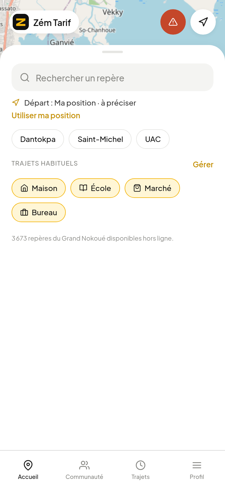

# Zém Tarif

Application de **prix de référence** pour les passagers d’une course en zémidjan à Cotonou, Abomey-Calavi et Porto-Novo. Slogan : **Le juste prix du zém**.

Le zém n’a pas de compteur. On se met d’accord avant de monter, selon la distance, l’heure et parfois la pluie. Beaucoup de conducteurs ne lisent pas : l’application s’adresse donc au passager, qui peut montrer le prix en très grands chiffres. Il n’existe pas, à notre connaissance, de grille officielle ou syndicale en vigueur pour le zém de rue. Zém Tarif calcule une fourchette à partir d’un barème transparent, utilisable hors ligne, que les passagers peuvent ensuite corriger en indiquant le prix réellement convenu. Les avis, pondérés selon leur cohérence, affinent la médiane de la communauté.

Ce n’est pas un prix imposé, et ce n’est pas GoZem ni Yango.

- Démo en ligne : [zem-tarif.onrender.com](https://zem-tarif.onrender.com)
- Code source : [github.com/bienvenuessegnon/zem-tarif](https://github.com/bienvenuessegnon/zem-tarif)
- API : [zem-tarif-api.onrender.com](https://zem-tarif-api.onrender.com)



## Fonctions (version 1.2)

- Carte en plein écran et feuille du bas réglable (trois hauteurs), avec l’accueil « Où allez-vous ? » et l’écran de prix de référence.
- Recherche locale de plus de 3 600 repères du Grand Nokoué (marchés, carrefours, pharmacies, lieux de culte, campus, gares, hôpitaux, quartiers), insensible aux accents, utilisable hors ligne. Les données viennent d’OpenStreetMap (ODbL). Un repère manquant peut être suggéré.
- Mode hors ligne complet : le barème et les repères sont sur l’appareil. L’itinéraire passe par OSRM en ligne, ou à défaut par la distance à vol d’oiseau majorée d’un facteur de détour de 1,3. Un badge l’indique. Les signalements et suggestions restent en file et partent plus tard.
- Fourchette en francs CFA, distance et durée indicative. Majoration de nuit (22 h – 6 h, heure de Porto-Novo), option pluie, et supplément bagages (aucun, petit sac, gros colis, sacs du marché). Les coefficients bagages sont des hypothèses de travail, pas une enquête de terrain, et se règlent dans `src/pricing/constantes.ts`.
- Trajets habituels (Maison, école, marché, bureau…) enregistrés sur l’appareil, avec une icône, et un tap sur l’accueil pour obtenir le prix, même hors ligne.
- Budget transport : totaux de la semaine et du mois, graphique des 7 derniers jours, plafond mensuel facultatif, export CSV. Les sommes restent sur l’appareil. Une invitation apparaît après une estimation ; un signalement est aussi noté automatiquement.
- Trajet partagé : un lien public (page `/suivi` de la démo) montre la position en direct. Le jeton expire à la fin de la course, ou au plus tard au bout de six heures. Aucun compte n’est demandé.
- Bouton SOS (appui long de 3 secondes) : ouvre un SMS vers les contacts d’urgence avec un lien de position, puis un appel vers le premier contact si le téléphone le permet. Hors ligne, le SMS utilise la dernière position GPS connue.
- Signalement en deux gestes : jetons de prix, tags nuit / pluie / bagages. Un score de fiabilité, calculé côté serveur à partir de l’historique de l’appareil, pondère les avis. Les écarts importants pèsent moins, ils ne sont pas masqués. S’il n’y a pas encore d’avis sur un trajet, l’écran le dit clairement.
- « Montrer au zém » : plein écran très contrasté, grands chiffres et fourchette, écran qui reste allumé, peu de texte, pour le montrer au conducteur.
- Carte de prix partageable (image et lien). Le lien rouvre la démo sur le même trajet. Sur le web : téléchargement de l’image ou API Web Share ; sur Android : feuille de partage (WhatsApp, statut, copie du lien).
- Écran d’accueil animé, courte introduction, pseudo facultatif (pas de compte).
- Historique, favoris, communauté, conseils, méthode et sources.
- L’application tourne dans Expo Go (Android), dans un navigateur, et via un fichier APK.

Un serveur FastAPI rassemble les avis dans une base PostgreSQL. Sans serveur, ou si le service gratuit est endormi, tout reste utilisable en local.

## Le barème

Tous les coefficients tiennent dans `src/pricing/constantes.ts`. C’est le seul fichier à modifier si de nouveaux prix de terrain sont fournis.

```
prix = max(250 F, 150 F + 65 F × km)
puis, le cas échéant :
  × 1,25 la nuit (22 h – 6 h)
  × 1,30 s’il pleut ou si la voie est très dégradée
  × coefficient bagages (aucun 1,00 ; petit sac 1,10 ; gros colis 1,25 ; sacs du marché 1,40)
arrondi à 50 F
fourchette affichée : 85 % – 130 % du point central
```

Dès que trois avis d’usagers relient à peu près les mêmes deux points (dans un rayon d’un kilomètre à chaque bout), le point central glisse vers leur médiane, jusqu’à 65 % du poids. Les repères publiés ci-dessous ne sont pas des avis d’usagers et n’entrent pas dans ce mélange.

Les coefficients bagages sont des hypothèses de travail, à ajuster si une enquête de terrain est disponible. Ils ne prétendent pas refléter une pratique mesurée.

Les distances de calage ont été mesurées avec OSRM (profil routier). Le barème a été recalibré en novembre 2026, après la hausse du carburant officiel à 725 F le litre (1er mai 2026) et des témoignages plus récents sur les courses courtes.

Exemples, de jour et par temps sec :

| Trajet | Distance (ordre de grandeur) | Point central |
|---|---|---|
| Haie Vive – Cadjèhoun | ~2,4 km | 300 F (fourchette 250 – 400 F) |
| Haie Vive – Ganhi | ~5,3 km | 500 F (fourchette 400 – 650 F) |
| Fidjrossè – Akpakpa | ~11,7 km | 900 F (fourchette 750 – 1 200 F) |
| Vers Calavi, ~16 km | ~16 km | 1 200 F (fourchette 1 000 – 1 550 F) |

### D’où viennent les chiffres

Il n’y a pas de série statistique récente, trajet par trajet. Le barème a été calé pour rester dans les fourchettes publiées en 2025–2026. Les sources principales :

| Trajet ou ordre de grandeur | Fourchette | Année | Source |
|---|---|---|---|
| Course courte, après la flambée du kpayo | 250 – 300 F | 2026 | [Ahouandjo, 12 novembre 2026](https://ahouandjo.com/article.php?slug=ahouandjo.com%2Fflambee-du-Kpayo-zemidjans-et-usagers-pris-au-piege-de-la-cherte) |
| Court, moins de 10 min (après négociation) | 200 – 400 F | 2026 | [benin360.com, mai 2026](https://benin360.com/transport-cotonou-benin/) |
| Moyen, 15 à 20 min, après négociation | 500 – 700 F | 2026 | même article |
| Long, 30 min et plus, après négociation | 800 – 1 200 F | 2026 | même article |
| Court, même quartier (ex. Haie Vive – Cadjèhoun, env. 2,4 km) | 200 – 300 F | 2026 | [icotonou.com](https://www.icotonou.com/en/installation/riding-zemidjan-cotonou/) (14 septembre 2026) |
| Moyen (ex. Haie Vive – Ganhi, env. 5,3 km) | 400 – 700 F | 2026 | même guide |
| Long, traversée de ville (ex. Fidjrossè – Akpakpa, env. 11,7 km) | 700 – 1 000 F | 2026 | même guide |
| Cotonou centre – débarcadère d’Abomey-Calavi | 1 000 – 1 500 F | 2026 | même guide |
| Trajet intra-urbain de moins de 10 km | 200 – 1 500 F | 2026 | [Parlons Fongbé](https://parlons-fongbe.com/en/motorcycle-taxis-and-car-taxis-in-benin/) (3 novembre 2026) |
| Gozem Zem, courses en ville observées | typiquement 300 – 800 F, parfois jusqu’à 1 200 F | 2026 | [benin360](https://benin360.com/transport-cotonou-benin/) et [icotonou.com, 23 juillet 2026](https://www.icotonou.com/en/articles/ride-hailing-apps-cotonou/) |
| Petit trajet typique | 100 – 1 000 F | 2024 | [Le Petit Journal Cotonou](https://lepetitjournal.com/cotonou/zem-les-taxis-moto-du-benin-299763) (Julie Ducos, 8 décembre 2024) |
| Court trajet à Cotonou, 0 à 3 km | 100 – 250 F | 2019 | [SSATP / Banque mondiale](https://www.ssatp.org/sites/default/files/publication/Country-Assesment-report-Benin-En.pdf), octobre 2019, p. 40 |
| Calavi – Cotonou, 15 à 20 km | 500 – 1 000 F | 2019 | même rapport SSATP, p. 40 |
| Course moyenne, pouvant aller jusqu’au triple | 300 F en moyenne, jusqu’à 900 F | 2019 | [Ouest-Afrique](https://ouest-afrique.com/cotonou-face-a-la-penurie-de-transports-publics/) (Max-Savi Carmel, d’après *New African*) |
| Minimum historique de la course | 100 F | 2017 | [franceinfo](https://www.franceinfo.fr/monde/afrique/societe-africaine/au-benin-l-uberisation-touche-desormais-les-moto-taxis_3059165.html), [Wikipedia](https://en.wikipedia.org/wiki/Zemidjan) |

Le rapport SSATP de 2019 reste la source la plus solide, mais elle a sept ans. Les guides et articles de 2026 donnent des ordres de grandeur plus à jour, sans être des enquêtes de terrain contrôlées. Le barème se situe dans ces fourchettes récentes : 250 F de plancher (plutôt que le minimum historique de 100 F), 500 F pour Haie Vive–Ganhi, autour de 900 F pour une traversée de ville.

La grille officielle [Yango Moto à Cotonou](https://yango.com/cotonou/tariff/moto/) (valable jusqu’au 17 novembre 2026) affiche un minimum de 85 F, comprenant 5 minutes et 2 km, puis au plus 18 F/km et 8 F/min en ville. C’est un plafond de plateforme, très en dessous des prix de rue : elle est documentée comme point de comparaison, et n’a pas servi à baisser le barème. Gozem Zem, tel qu’observé dans les guides, est un meilleur point de référence pour une moto commandée, sans être une grille de zém de rue.

### Nuit, pluie, carburant

- **Nuit.** Le guide icotonou.com (2026) indique environ +20 à 30 % après 22 h. Le modèle prend 1,25. D’autres récits parlent d’une hausse plus forte, parfois jusqu’à un doublement (benin360, mai 2026) : la fourchette haute en absorbe une partie, sans aller jusque-là.
- **Pluie.** En juillet 2014, *La Nouvelle Tribune* rapportait un trajet habituel à 400 F payé 600 F sous la pluie, sur une voie dégradée à Agla. Le coefficient 1,30 reste en deçà de ce témoignage.
- **Carburant.** Le rapport SSATP citait environ 535 F le litre à la pompe en 2019. Le tarif officiel était de 695 F en 2025, puis 725 F à compter du 1er mai 2026 ([RFI](https://www.rfi.fr/fr/afrique/20260502-b%C3%A9nin-les-prix-du-carburant-%C3%A0-la-pompe-revus-%C3%A0-la-hausse-depuis-le-1er-mai), [La Marina BJ](https://lamarina.bj/2026/04/30/carburant-au-benin-le-prix-a-la-pompe-fixe-a-725-fcfa-des-le-1er-mai/)). Beaucoup de conducteurs s’approvisionnent toutefois en essence informelle (« kpayo »), dont le prix est instable : [Ahouandjo, 12 novembre 2026](https://ahouandjo.com/article.php?slug=ahouandjo.com%2Fflambee-du-Kpayo-zemidjans-et-usagers-pris-au-piege-de-la-cherte) cite 1 000 à 1 200 F le litre à certains points, et des courses courtes passées de 200–250 F à 250–300 F. Il n’existe pas d’indexation automatique des courses.

Aucune grille municipale de prix au kilomètre n’a été trouvée. La mairie de Cotonou prélève une taxe annuelle d’exploitation (4 800 F pour un deux-roues en 2024, d’après *La Nouvelle Tribune*), ce qui n’est pas un tarif de course.

## Limites

- Les données précises, récentes et comparables d’un quartier à l’autre restent rares.
- Le modèle ignore le nombre de passagers, les bagages, et le fait qu’un visiteur se voit souvent proposer plus cher.
- La durée affichée vient d’OSRM. Elle est souvent optimiste aux heures de pointe.
- Au-delà d’une vingtaine de kilomètres, un taxi collectif est souvent plus économique. Cotonou–Porto-Novo se situe autour de 1 500 F en taxi partagé, selon Parlons Fongbé.
- Sans avis d’usagers sur un trajet, l’estimation reste celle du barème de base.

## Identité visuelle

La marque est un monogramme « Z » géométrique, or sur carré noir arrondi (`assets/logo/`). La palette est noire et or (encre `#111111`, or `#F3B409`, fond `#F4F4F2`), avec Plus Jakarta Sans. Les icônes viennent de Feather (`@expo/vector-icons`), au même trait.

## Lancer l’application

Il faut Node.js 20 ou plus, et npm.

```bash
cd zem-tarif
npm install
npm test
npm run web
```

Sur un téléphone Android, installer [Expo Go](https://expo.dev/go), puis :

```bash
npm start
```

Scanner le QR code affiché. L’application demande la position uniquement si l’on choisit d’utiliser sa position.

### Démo web statique

Une version publique est en ligne : [https://zem-tarif.onrender.com](https://zem-tarif.onrender.com).

```bash
npm run export:web
```

Le dossier `dist/` peut être servi par n’importe quel hébergeur de fichiers statiques (Render, Vercel, GitHub Pages, etc.). Comme la navigation est côté client, il faut renvoyer toutes les routes vers `index.html`. Le fichier `public/_redirects` le fait pour Render et Netlify ; `vercel.json` le fait pour Vercel.

### Fichier APK Android et publication sur le Play Store

Le fichier `eas.json` prévoit deux profils Android :

- `preview` : fichier APK, pour une installation directe (partage interne).
- `production` : fichier AAB (`app-bundle`), exigé par le Play Store.

```bash
npm install --global eas-cli
eas login
eas build --platform android --profile preview      # APK
eas build --platform android --profile production   # AAB
```

Les APK, pour installation directe, sont sur la page des versions :

- [zem-tarif-1.2.0.apk](https://github.com/bienvenuessegnon/zem-tarif/releases/download/v1.2.0/zem-tarif-1.2.0.apk) (version courante, [v1.2.0](https://github.com/bienvenuessegnon/zem-tarif/releases/tag/v1.2.0))
- [zem-tarif-1.1.1.apk](https://github.com/bienvenuessegnon/zem-tarif/releases/download/v1.1.1/zem-tarif-1.1.1.apk)
- [zem-tarif-1.1.0.apk](https://github.com/bienvenuessegnon/zem-tarif/releases/download/v1.1.0/zem-tarif-1.1.0.apk)
- [zem-tarif-1.0.1.apk](https://github.com/bienvenuessegnon/zem-tarif/releases/download/v1.0.1/zem-tarif-1.0.1.apk)
- [zem-tarif-1.0.0.apk](https://github.com/bienvenuessegnon/zem-tarif/releases/download/v1.0.0/zem-tarif-1.0.0.apk)

Ces fichiers ont été signés localement avec le keystore de débogage ; ils conviennent à un essai sur un téléphone, pas à une mise en ligne sur le Play Store (qui exige un AAB et une clé de production). Un APK signé avec cette clé ne pourra pas être remplacé plus tard par une version EAS ou Play Store.

On peut aussi construire un APK en local, après avoir installé un JDK 17 et le SDK Android, avec `npx expo prebuild --platform android` puis `cd android && ./gradlew assembleRelease`.

Pour publier sur le Play Store :

1. Créer un compte [Google Play Console](https://play.google.com/console) (frais d’inscription uniques de 25 dollars US).
2. Créer une fiche d’application (titre, description courte et longue, captures d’écran téléphone, icône, typologie, classification du contenu).
3. Fournir une politique de confidentialité : l’application demande la position uniquement pour proposer un départ, et un pseudo facultatif, sans compte.
4. Envoyer le fichier AAB produit par le profil `production`, puis suivre le parcours de test interne, de test fermé, éventuellement de test ouvert, avant la production.
5. Renseigner la déclaration de données (position, identifiant d’appareil, avis de prix, pseudo s’il est renseigné).

### Serveur et base de données

L’API publique est [https://zem-tarif-api.onrender.com](https://zem-tarif-api.onrender.com). Pour un serveur local :

```bash
cd backend
python3 -m venv .venv
source .venv/bin/activate
pip install -r requirements.txt
uvicorn main:app --reload --port 8000
```

À la racine du projet, créer un fichier `.env` :

```
EXPO_PUBLIC_API_URL=http://localhost:8000
```

Une chaîne vide (`EXPO_PUBLIC_API_URL=`) désactive le réseau.

Points d’entrée principaux : `GET /sante`, `POST /signalements`, `GET /stats`, `GET /fiabilite`, `POST /suggestions`, `GET /zones-demandees`. Un identifiant d’appareil limite les envois (8 par heure, 20 par jour). Les prix hors de l’intervalle 50–20 000 F sont refusés. La médiane communautaire est pondérée par la fiabilité de chaque appareil. Si l’envoi échoue, l’avis reste sur l’appareil et sera renvoyé plus tard.

La base de production est un PostgreSQL Render, plan gratuit, région Francfort. Selon la [documentation Render](https://render.com/docs/free.md), une base gratuite expire 30 jours après sa création, avec un délai de grâce de 14 jours pour passer à un plan payant, après quoi elle est supprimée. Elle est limitée à 1 Go, il n’y en a qu’une par espace de travail, et aucun sauvegarde n’est fournie. Les services web gratuits s’endorment après 15 minutes d’inactivité (le réveil prend environ une minute).

Si cette base expire, le schéma `backend/schema.sql` peut être repris tel quel sur [Supabase](https://supabase.com/) ou [Neon](https://neon.tech/), qui proposent aussi des offres gratuites plus durables. Il suffit alors de changer `DATABASE_URL` sur le service d’API.

### À quoi sert l’application

Le zém se négocie à chaque course. Zém Tarif s’adresse au passager : il donne un prix de référence, fondé sur la distance, l’heure et la pluie, et permet de le montrer en grand au conducteur, même s’il ne lit pas. Après la course, le passager peut signaler le prix réellement convenu. Plus les avis cohérents s’accumulent, plus la médiane de la communauté devient utile. Ce n’est pas un tarif imposé : c’est un point de départ pour se mettre d’accord, et un rappel de bon sens (s’entendre avant de monter, avoir de la monnaie, porter un casque).

## Captures

- [docs/accueil.png](docs/accueil.png) — accueil « Où allez-vous ? »
- [docs/recherche.png](docs/recherche.png) — recherche de repères
- [docs/reference.png](docs/reference.png) — prix de référence
- [docs/partage.png](docs/partage.png) — carte de prix à partager
- [docs/signaler.png](docs/signaler.png) — signaler un prix en deux gestes
- [docs/montrer.png](docs/montrer.png) — plein écran « Montrer au zém »
- [docs/habituels.png](docs/habituels.png) — trajets habituels sur l’accueil
- [docs/budget.png](docs/budget.png) — budget transport
- [docs/bagages.png](docs/bagages.png) — supplément bagages
- [docs/suivi.png](docs/suivi.png) — page publique de suivi d’un trajet
- [docs/splash.png](docs/splash.png) — écran d’accueil, logo et slogan
- [docs/onboarding.png](docs/onboarding.png) — introduction au premier lancement
- [docs/communaute.png](docs/communaute.png) — prix de la communauté
- [docs/conseils.png](docs/conseils.png) — conseils de négociation et de sécurité
- [docs/plus.png](docs/plus.png) — profil

## Technique

- React Native et Expo (TypeScript), Expo Router.
- Le calcul du prix, la recherche de repères et le score de fiabilité sont isolés et testés avec Jest.
- Jeu de repères : `assets/data/reperes.json`, extrait des données OpenStreetMap (© les contributeurs d’OpenStreetMap, [ODbL](https://opendatacommons.org/licenses/odbl/)). Extrait Geofabrik, Bénin.
- Cartes : tuiles OpenStreetMap, via Leaflet.
- Stockage local : AsyncStorage (historique, favoris, file d’attente, profil, recettes, suggestions).
- Animations : react-native-reanimated (feuille, compteur de prix, transitions).
- Typographie : Plus Jakarta Sans (SIL Open Font License).
- Fuseau horaire utilisé pour la nuit : Africa/Porto-Novo.
- API : FastAPI et PostgreSQL (SQLite en secours, en local).

Nominatim n’est plus nécessaire pour la recherche de repères, qui se fait en local. S’il est encore interrogé ailleurs, ce sera au plus une fois par seconde, avec un identifiant de contact, conformément à [sa politique d’usage](https://operations.osmfoundation.org/policies/nominatim/). Les cartes et le jeu de repères portent la mention © les contributeurs d’OpenStreetMap (ODbL).

## Licence

MIT © 2026 Bienvenu ESSEGNON
